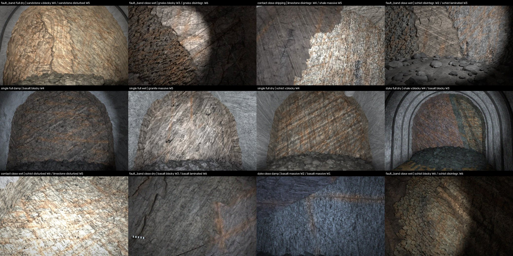
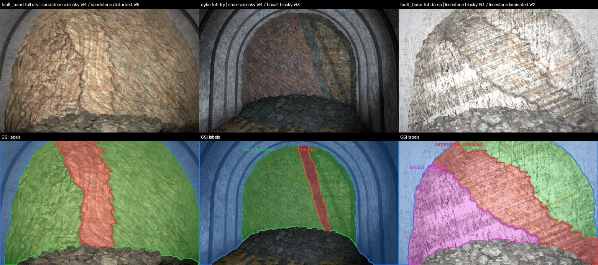
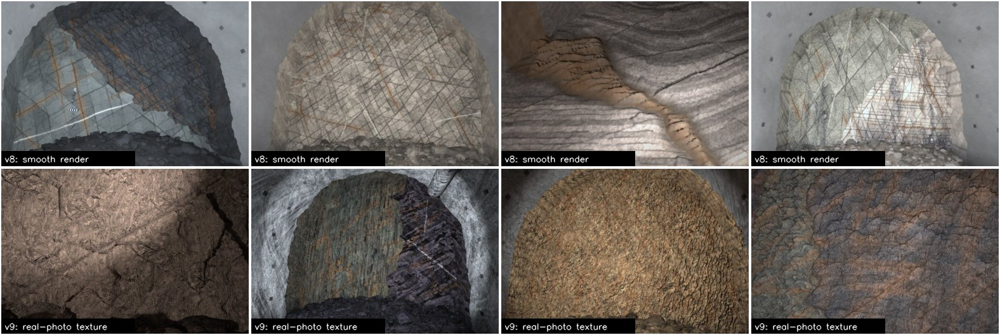
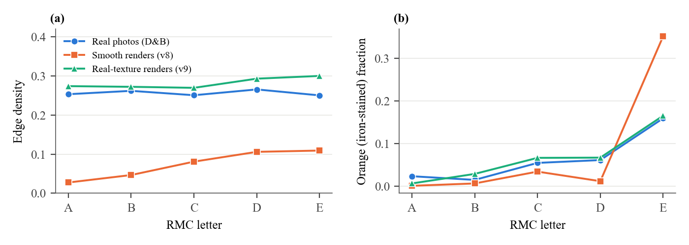
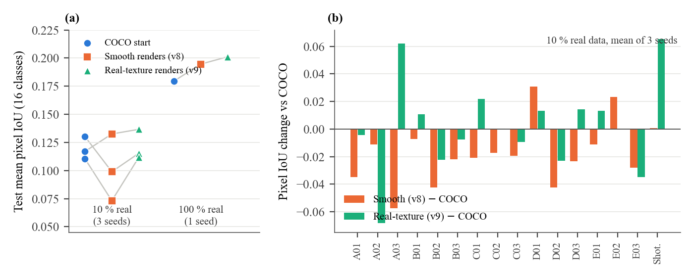
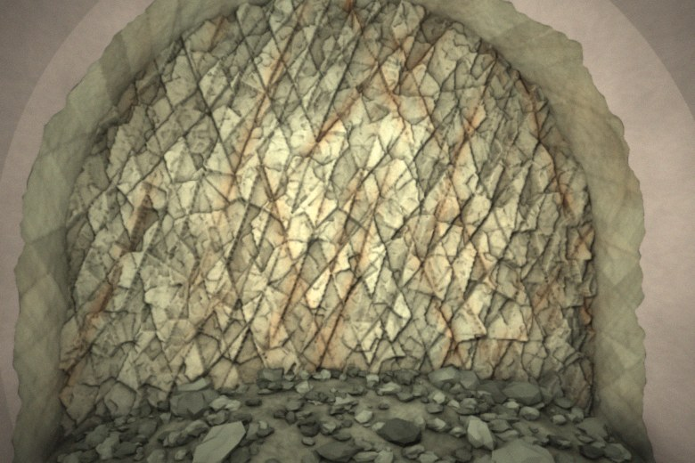
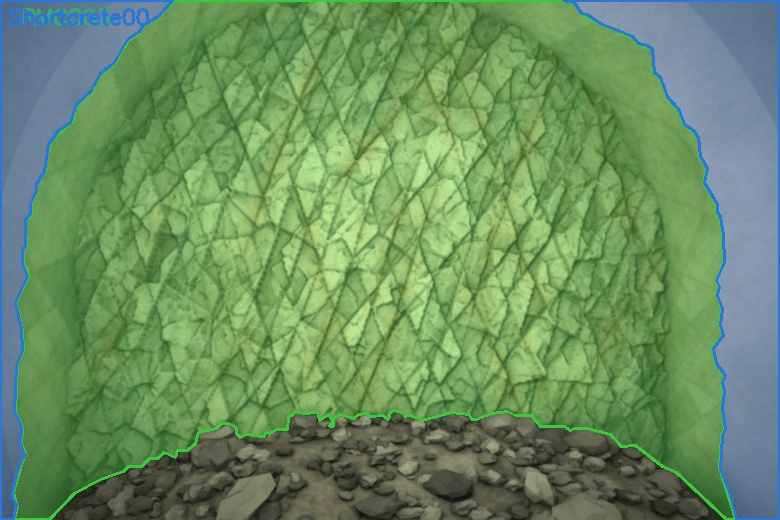
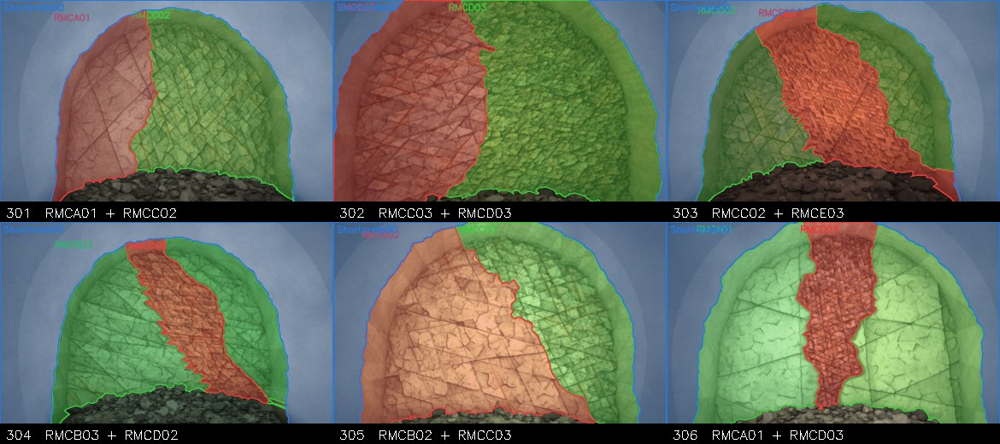
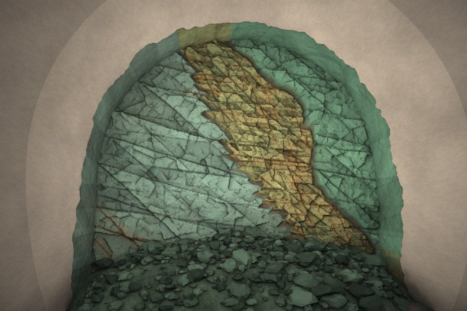
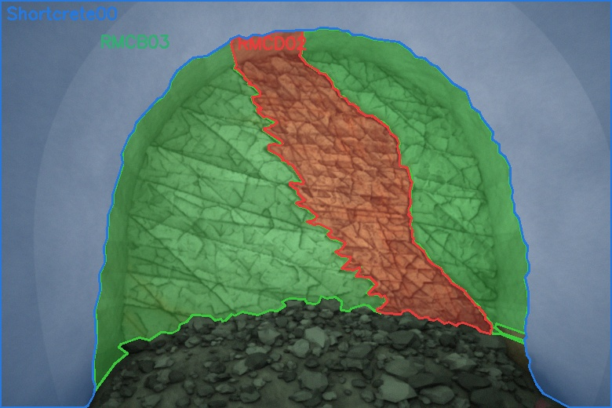

# Synthetic tunnel faces with rock-mass labels, in Blender and Rhino

This repository builds synthetic drill-and-blast tunnel faces with pixel-exact segmentation labels, for pretraining or augmenting rock-mass segmentation models such as YOLO-seg. It has two generators. The **Blender generator** (recommended, `tunnelgen/`, `blender/`) samples the geology of each face first, renders it with the Cycles path tracer on a GPU, and labels every zone with its Geological Strength Index (GSI) structure class and an RMC code; it runs headless on Linux and produces about one labelled face per 1.2-1.6 s on an RTX 5090. The original **Rhino generator** (`scripts/rhino_tunnel_face.py`) is kept below for interactive work.



Twelve random faces from the Blender generator (version v9, real-photo texture). Captions give the layout, framing, water condition and, for each zone, rock type, GSI structure class and ISRM weathering grade (W1 fresh to W6 residual soil).



Faces with several zones and their labels: a disturbed fault band in very blocky sandstone, a basalt dyke through very blocky shale, and a fault band separating intact and laminated limestone.

## Blender generator

### What it does

`tunnelgen/sampler.py` draws a job for each seed, geology first. A face has one to three zones (single rock mass, contact, fault band with clay gouge, or dyke), and each zone gets a GSI structure class (intact or massive, blocky, very blocky, blocky/disturbed/seamy, disintegrated, laminated or sheared), a rock type (granite, gneiss, schist, sandstone, shale, limestone, basalt), a weathering grade, and the joint sets, bedding, folds, veins and karst that follow from them. The job also fixes groundwater (dry to flowing, with seepage streaks), half-barrels of blast holes, bolt plates, steel sets, a scale bar, a ventilation duct, close-up or full framing, and flash or work-light illumination. `tunnelgen/geometry.py` turns the job into NumPy meshes (a 2.5 cm height field with joint steps, blast-fractured Voronoi facets, zone boundaries that bend, step and fray), and `blender/render_faces.py` renders them in Cycles together with an object-index pass, from which `scripts/label_tunnel_face.py` writes COCO and YOLO labels for two label sets, GSI classes (`labels_gsi/`) and RMC codes (`labels/`). See `docs/geological_patterns.md` for the geological reasoning.

### Real-photo texture (v9)

The first version (v8) coloured the rock procedurally, and its surfaces were far smoother than real photographs, with an edge density of 0.06 against 0.26 in real drill-and-blast photos. Worse, its edge density rose with rock-mass class while in real photos it does not, so a network pretrained on it learned a false cue. Version v9 box-projects class-blind, high-pass detail tiles cut from real training photographs onto every surface, adds blast cracks at a fixed physical scale, spreads iron staining over all classes, and adds harsher light and a camera model (gamma, flash hot spot, sensor noise, blur, JPEG quality). Its texture statistics match real photographs and no longer depend on class.





The texture bank is **not included** in this repository, because it is cut from a private image set. Build your own from any folder of labelled tunnel-face photographs in COCO format, using the training split only:

```bash
python3 scripts/make_texture_bank.py --real /path/to/train_split --out textures --tiles 2500
```

Without a `textures/` folder the renderer falls back to procedural grain (the v8 look).

### Running it

Locally (macOS or Linux, Blender 4.4+; CPU rendering is slow):

```bash
python3 scripts/blender_batch.py --foundation 20 --first-seed 0 --out output --workers 2 --device CPU --samples 8 --scale 0.5
```

On a Linux GPU box (tested on an RTX 5090 with Blender 4.5 LTS):

```bash
bash blender/setup_linux.sh 4.5          # installs Blender, Python packages, runs a smoke test
source blender/env.sh
python3 scripts/blender_batch.py --foundation 10000 --first-seed 300000 --out /data/syn --workers 8 --samples 32 --prune
```

Two settings matter for speed. Use the OptiX denoiser (the default here): Blender's default OpenImageDenoise cost about 22 s per frame on the RTX 5090, against 0.2 s for OptiX. Run several Blender workers in parallel, because geometry is built on the CPU; eight workers on 32 cores kept the GPU busy. `vast/run_foundation.sh` chains generation, pretraining and fine-tuning on a rented GPU box.

### Training and what we found

`train/foundation_train.py` pretrains YOLO26s-seg on the GSI labels, then fine-tunes on real data with a fixed protocol, comparing the synthetic start with the COCO start at 100 % and 10 % of the real training images; its `--stage mix` option trains real and synthetic data together with a down-weighted synthetic loss (`--syn-weight`) and a fixed number of synthetic batches per real batch (`--syn-per-real`). On a 3,962-image real tunnel-face dataset:

| Real training data | Start | Mask mAP50 | Mask mAP50-95 | Mean pixel IoU | Freq.-weighted pixel IoU | Labelled-pixel acc. |
|---|---|---|---|---|---|---|
| 10 % (3 seeds) | COCO | 0.155 | 0.103 | 0.119 | 0.189 | 0.248 |
| 10 % (3 seeds) | v8 smooth renders | 0.147 | 0.095 | 0.102 | 0.173 | 0.224 |
| 10 % (3 seeds) | v9 real-photo texture | 0.148 | 0.096 | 0.121 | 0.197 | 0.248 |
| 100 % (1 seed) | COCO | 0.222 | 0.151 | 0.180 | 0.257 | 0.324 |
| 100 % (1 seed) | v8 smooth renders | 0.256 | 0.177 | 0.195 | 0.259 | 0.332 |
| 100 % (1 seed) | v9 real-photo texture | 0.262 | 0.182 | 0.201 | 0.275 | 0.365 |



Smooth renders made low-data fine-tuning worse (mean pixel IoU -0.018, paired 95 % interval -0.032 to -0.004). Real-photo texture removed that loss (+0.020 over v8, interval +0.005 to +0.034) and drew level with COCO at 10 % data, and with all real data it was ahead of COCO on every metric, with labelled-pixel accuracy +0.041 (interval +0.001 to +0.083, one seed). Texture realism is therefore the condition for synthetic pretraining to help; with few real labels it removes the harm without yet producing a gain.

## Rhino generator


| Image (RMCC03) | Labels |
|---|---|
|  |  |

The Rhino generator builds the same kind of face interactively in Rhino 8 and labels it in the ROCK MASS LABELING COCO schema. The contact sheet shows two faces for each of the 15 RMC codes. A mixed mode builds faces with two zones separated by a contact, or three zones in which a weaker fault band with a clay gouge seam cuts through the host rock.



| Image | Labels |
|---|---|
|  |  |

### What the RMC labels mean, and what they do not

The source dataset uses the codes RMCA01 to RMCE03 plus `Shortcrete00`, but it does not define them. This generator therefore assumes the usual tunnel convention, in which A is the best rock mass and E the worst, and the suffixes 01 to 03 grade from better to worse within a letter. The class appearance table in `scripts/batch_tunnel_faces.py` (`CLASSES`) is a visual archetype for each letter, not a rating from RMR, Q or GSI. Check a few faces against what your site geologists call each class, and edit that table if their codebook differs. The images still look computer-generated, so use them as additional training data and judge any gain only on real test photographs.

Each image gets one annotation per RMC code present, which may hold several polygons, and one `Shortcrete00` annotation for the visible lining. Muck, floor and background stay unlabelled, as in the real data. The COCO file keeps the original 16 categories with the same ids (0 to 15), and the YOLO-seg label uses the COCO `category_id` as its class index. The `area` field holds the true mask pixel count, whereas the original dataset stores bounding-box width times height.

### Requirements

You need Rhino 8 (macOS or Windows) with the RhinoMCP plugin, and Python 3.9 or newer with NumPy and OpenCV. Claude Code is optional, and it is only needed if you want to drive Rhino by conversation.

```bash
pip install -r requirements.txt
```

### Connecting Rhino

The scripts talk to Rhino through the RhinoMCP plugin (https://github.com/jingcheng-chen/rhinomcp, tested with version 0.4.1.1). The plugin runs a small TCP server inside Rhino on `127.0.0.1:1999`, and `scripts/rhino_bridge.py` sends IronPython code to that server, which Rhino then runs in the active document.

1. In Rhino 8, open **Tools > Package Manager**, search for `rhinomcp`, install it and restart Rhino.
2. Type `mcpstart` in the Rhino command line. The server now listens on port 1999, and `mcpstop` closes it again.
3. Check the link from a terminal. The command should print a JSON reply with `"status": "success"`.

```bash
python3 scripts/rhino_bridge.py --cmd get_document_summary
```

To use another host or port, set `RHINO_BRIDGE_HOST` and `RHINO_BRIDGE_PORT` before running the scripts.

The generator refuses to run in a document that holds objects it did not create, so your own models are never touched. Open a new, empty document (**File > New**, or `_-New _None` in the command line) before the first run. Later runs delete and rebuild only the objects that carry the generator tag.

### Running the generator

All output goes to `output/` unless you pass `--out`. The per-class mode makes a given number of faces for each RMC code, and the mixed mode makes faces with two or three zones.

```bash
# two faces for each of the 15 RMC codes (seeds 101-130)
python3 scripts/batch_tunnel_faces.py --per-class 2 --first-seed 101

# only some codes
python3 scripts/batch_tunnel_faces.py --per-class 3 --codes A01,C02,E03 --first-seed 501

# 20 faces with contacts or fault bands (seeds 301-320)
python3 scripts/batch_tunnel_faces.py --mixed 20 --first-seed 301

# contact sheet of the label overlays for review
python3 scripts/contact_sheet_tunnel_faces.py --seeds 301-320 --out output/mixed_sheet.jpg
```

One face takes about 30 s for a single zone and about 75 s for a mixed face on an Apple-silicon Mac, because the noise and boundary functions run per vertex in IronPython. The same seed always gives the same scene, and rerunning a seed replaces its earlier entry in the COCO file rather than adding a duplicate.

The output folder is laid out as follows.

| Path | Content |
|---|---|
| `output/dataset/images/tunnel_face_NNN.jpg` | 780 x 520 photo-like image |
| `output/dataset/_annotations.coco.json` | COCO annotations, original 16 categories |
| `output/dataset/labels/tunnel_face_NNN.txt` | YOLO-seg polygons, class = COCO `category_id` |
| `output/dataset/tunnel_face_NNN_overlay.jpg` | labels drawn on the image, for checking |
| `output/render/tunnel_face_NNN_rgb.png`, `_id.png` | raw 1560 x 1040 Rhino captures |
| `output/render/tunnel_face_NNN_job.json` | every parameter of the scene, to rebuild or relabel it |

### How the pipeline works

`batch_tunnel_faces.py` draws a job for each seed, which holds the rock colour, the joint sets, the per-zone condition, the zone boundaries, the muck pile and the camera, and writes it to `output/job.json`. It then sends `rhino_tunnel_face.py` to Rhino, where the script builds the meshes with vertex colours, renders the shaded view with a key spotlight, recolours every mesh with a flat ID colour and renders the same view again. `label_tunnel_face.py` downsamples the shaded view and adds flash fall-off, grain and a slight warm cast. It decodes the ID view by chromaticity, so that anti-aliased pixels on region edges stay unassigned, and writes the image, the COCO and YOLO labels and the overlay.

The rock face is a height field on a 3.5 cm grid. Its relief adds stepped, tilted blocks bounded by irregular, non-persistent joint traces, two scales of Voronoi facets that imitate blast fracturing, a third fine scale for crushed rock and smooth noise. Its colour combines the block tone, mottling, crystal speckle, darkened joint traces, iron staining along a fraction of the joints, weathering toward a soil-like brown and a wet lower face. A mixed face is split into one mesh per zone, so each zone has its own ID colour.

## Working with Claude Code

Claude Code can run the whole loop by conversation, with the MCP connection used for looking at and editing the Rhino scene and the scripts used for batches. Register the RhinoMCP server once, with Rhino open and `mcpstart` running.

```bash
claude mcp add rhino --scope user --env RHINO_MCP_HOST=127.0.0.1 -- uvx rhinomcp@latest
```

Restart Claude Code, and the `mcp__rhino__*` tools appear, among them `capture_viewport`, `get_document_summary` and `execute_rhinoscript_python_code`. `uvx` comes with `uv` (https://docs.astral.sh/uv/). A session that built this repository used requests like the following, in this order.

- "Generate a picture of rock in a tunnel face in Rhino, then label it in the same system as the ROCK MASS LABELING dataset."
- "Generate 20 more faces with different seeds."
- "Create different classes of rock in the tunnel face." Claude tied the rock condition to each RMC code (the `CLASSES` table) rather than only changing the label.
- "Can you have two or three classes in a single image?" This request added zones, fault bands and gouge seams.
- "Make the fault boundaries more irregular."

Ask Claude to show you the overlay or a contact sheet after each change, because a scene that renders without error can still look wrong. The `CLAUDE.md` file in this folder gives Claude the pitfalls found so far.

### Known Rhino pitfalls

`Rhino.Display.ViewCapture` returns a grey wireframe without vertex colours when the display mode has shadows on, so the generator captures with `view.CaptureToBitmap(size, display_mode)` instead. In IronPython, `json.dump` to a file opened with `open()` writes nothing until the file is closed, so close every file explicitly. Do not run two generator jobs at once, because they share the Rhino document and `output/job.json`. Stopping a batch while Rhino is rendering a seed can leave the plugin unresponsive. If every request then times out, close any dialog in Rhino and run `mcpstop` followed by `mcpstart`, or restart Rhino.

## Files

| File | Runs in | Role |
|---|---|---|
| `tunnelgen/sampler.py` | Python 3 | geology-first job sampler (GSI, rock type, weathering, layout, water, support, camera, light) |
| `tunnelgen/geometry.py` | Python 3 (NumPy) | scene geometry, colours, wetness and labels from a job |
| `blender/render_faces.py` | Blender 4.4+ | Cycles render, real-photo texture material, object-index masks |
| `blender/setup_linux.sh`, `blender/smoke_test.py` | Linux GPU box | install Blender and check the GPU |
| `scripts/blender_batch.py` | Python 3 | parallel Blender workers, labelling, COCO merge |
| `scripts/make_texture_bank.py` | Python 3 | detail tiles from your own training photographs |
| `scripts/label_tunnel_face.py` | Python 3 | photo finishing, camera model, GSI and RMC labels |
| `train/foundation_train.py` | Python 3 + Ultralytics | pretraining, matched fine-tuning, loss-weighted mixed training |
| `vast/run_foundation.sh` | GPU box | generation, pretraining and fine-tuning in one run |
| `scripts/rhino_tunnel_face.py` | Rhino 8 (IronPython 2.7) | Rhino generator |
| `scripts/batch_tunnel_faces.py` | Python 3 | Rhino class table, mixed-zone jobs, drives Rhino |
| `scripts/contact_sheet_tunnel_faces.py` | Python 3 | review sheet of overlays |
| `scripts/rhino_bridge.py` | Python 3 | TCP client for the RhinoMCP plugin |
