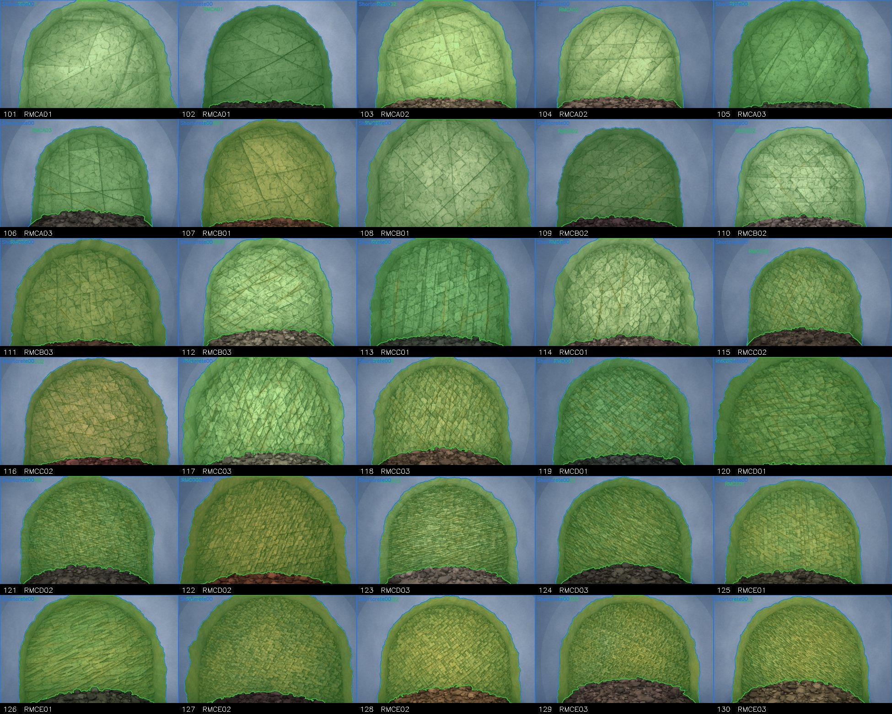

# Synthetic tunnel faces with rock-mass-class labels from Rhino

This repository builds synthetic drill-and-blast tunnel faces in Rhino 8 and labels them in the same COCO schema as the ROCK MASS LABELING dataset, so the images can be added to a rock-mass-class (RMC) segmentation training set. Each face carries one or more rock zones whose joint spacing, blast fracturing, crushing, weathering and iron staining follow an RMC code. The face also has an unsupported rock strip, a shotcrete lining with a ragged front edge, a muck pile and the tunnel floor. Rhino renders a shaded view and a flat-colour ID view from the same camera, and the ID view gives pixel-exact masks, so the labels contain no hand-drawing error.



The figure above shows two faces for each of the 15 RMC codes with their label overlays. A mixed mode builds faces with two zones separated by a contact, or three zones in which a weaker fault band with a clay gouge seam cuts through the host rock. The boundaries bend over metres, step sideways in an en-echelon pattern and are ragged at about 0.3 m.

## What the labels mean, and what they do not

The source dataset uses the codes RMCA01 to RMCE03 plus `Shortcrete00`, but it does not define them. This generator therefore assumes the usual tunnel convention, in which A is the best rock mass and E the worst, and the suffixes 01 to 03 grade from better to worse within a letter. The class appearance table in `scripts/batch_tunnel_faces.py` (`CLASSES`) is a visual archetype for each letter, not a rating from RMR, Q or GSI. Check a few faces against what your site geologists call each class, and edit that table if their codebook differs. The images still look computer-generated, so use them as additional training data and judge any gain only on real test photographs.

Each image gets one annotation per RMC code present, which may hold several polygons, and one `Shortcrete00` annotation for the visible lining. Muck, floor and background stay unlabelled, as in the real data. The COCO file keeps the original 16 categories with the same ids (0 to 15), and the YOLO-seg label uses the COCO `category_id` as its class index. The `area` field holds the true mask pixel count, whereas the original dataset stores bounding-box width times height.

## Requirements

You need Rhino 8 (macOS or Windows) with the RhinoMCP plugin, and Python 3.9 or newer with NumPy and OpenCV. Claude Code is optional, and it is only needed if you want to drive Rhino by conversation.

```bash
pip install -r requirements.txt
```

## Connecting Rhino

The scripts talk to Rhino through the RhinoMCP plugin (https://github.com/jingcheng-chen/rhinomcp, tested with version 0.4.1.1). The plugin runs a small TCP server inside Rhino on `127.0.0.1:1999`, and `scripts/rhino_bridge.py` sends IronPython code to that server, which Rhino then runs in the active document.

1. In Rhino 8, open **Tools > Package Manager**, search for `rhinomcp`, install it and restart Rhino.
2. Type `mcpstart` in the Rhino command line. The server now listens on port 1999, and `mcpstop` closes it again.
3. Check the link from a terminal. The command should print a JSON reply with `"status": "success"`.

```bash
python3 scripts/rhino_bridge.py --cmd get_document_summary
```

To use another host or port, set `RHINO_BRIDGE_HOST` and `RHINO_BRIDGE_PORT` before running the scripts.

The generator refuses to run in a document that holds objects it did not create, so your own models are never touched. Open a new, empty document (**File > New**, or `_-New _None` in the command line) before the first run. Later runs delete and rebuild only the objects that carry the generator tag.

## Running the generator

All output goes to `output/` unless you pass `--out`. The per-class mode makes a given number of faces for each RMC code, and the mixed mode makes faces with two or three zones.

```bash
# two faces for each of the 15 RMC codes (seeds 101-130)
python3 scripts/batch_tunnel_faces.py --per-class 2 --first-seed 101

# only some codes
python3 scripts/batch_tunnel_faces.py --per-class 3 --codes A01,C02,E03 --first-seed 501

# 20 faces with contacts or fault bands (seeds 301-320)
python3 scripts/batch_tunnel_faces.py --mixed 20 --first-seed 301

# contact sheet of the label overlays for review
python3 scripts/contact_sheet_tunnel_faces.py --seeds 301-320 --out output/mixed_sheet.jpg
```

One face takes about 30 s for a single zone and about 75 s for a mixed face on an Apple-silicon Mac, because the noise and boundary functions run per vertex in IronPython. The same seed always gives the same scene, and rerunning a seed replaces its earlier entry in the COCO file rather than adding a duplicate.

The output folder is laid out as follows.

| Path | Content |
|---|---|
| `output/dataset/images/tunnel_face_NNN.jpg` | 780 x 520 photo-like image |
| `output/dataset/_annotations.coco.json` | COCO annotations, original 16 categories |
| `output/dataset/labels/tunnel_face_NNN.txt` | YOLO-seg polygons, class = COCO `category_id` |
| `output/dataset/tunnel_face_NNN_overlay.jpg` | labels drawn on the image, for checking |
| `output/render/tunnel_face_NNN_rgb.png`, `_id.png` | raw 1560 x 1040 Rhino captures |
| `output/render/tunnel_face_NNN_job.json` | every parameter of the scene, to rebuild or relabel it |

## How the pipeline works

`batch_tunnel_faces.py` draws a job for each seed, which holds the rock colour, the joint sets, the per-zone condition, the zone boundaries, the muck pile and the camera, and writes it to `output/job.json`. It then sends `rhino_tunnel_face.py` to Rhino, where the script builds the meshes with vertex colours, renders the shaded view with a key spotlight, recolours every mesh with a flat ID colour and renders the same view again. `label_tunnel_face.py` downsamples the shaded view and adds flash fall-off, grain and a slight warm cast. It decodes the ID view by chromaticity, so that anti-aliased pixels on region edges stay unassigned, and writes the image, the COCO and YOLO labels and the overlay.

The rock face is a height field on a 3.5 cm grid. Its relief adds stepped, tilted blocks bounded by irregular, non-persistent joint traces, two scales of Voronoi facets that imitate blast fracturing, a third fine scale for crushed rock and smooth noise. Its colour combines the block tone, mottling, crystal speckle, darkened joint traces, iron staining along a fraction of the joints, weathering toward a soil-like brown and a wet lower face. A mixed face is split into one mesh per zone, so each zone has its own ID colour.

## Working with Claude Code

Claude Code can run the whole loop by conversation, with the MCP connection used for looking at and editing the Rhino scene and the scripts used for batches. Register the RhinoMCP server once, with Rhino open and `mcpstart` running.

```bash
claude mcp add rhino --scope user --env RHINO_MCP_HOST=127.0.0.1 -- uvx rhinomcp@latest
```

Restart Claude Code, and the `mcp__rhino__*` tools appear, among them `capture_viewport`, `get_document_summary` and `execute_rhinoscript_python_code`. `uvx` comes with `uv` (https://docs.astral.sh/uv/). A session that built this repository used requests like the following, in this order.

- "Generate a picture of rock in a tunnel face in Rhino, then label it in the same system as the ROCK MASS LABELING dataset."
- "Generate 20 more faces with different seeds."
- "Create different classes of rock in the tunnel face." Claude tied the rock condition to each RMC code (the `CLASSES` table) rather than only changing the label.
- "Can you have two or three classes in a single image?" This request added zones, fault bands and gouge seams.
- "Make the fault boundaries more irregular."

Ask Claude to show you the overlay or a contact sheet after each change, because a scene that renders without error can still look wrong. The `CLAUDE.md` file in this folder gives Claude the pitfalls found so far.

## Known Rhino pitfalls

`Rhino.Display.ViewCapture` returns a grey wireframe without vertex colours when the display mode has shadows on, so the generator captures with `view.CaptureToBitmap(size, display_mode)` instead. In IronPython, `json.dump` to a file opened with `open()` writes nothing until the file is closed, so close every file explicitly. Do not run two generator jobs at once, because they share the Rhino document and `output/job.json`.

## Files

| File | Runs in | Role |
|---|---|---|
| `scripts/rhino_tunnel_face.py` | Rhino 8 (IronPython 2.7) | builds one scene, renders RGB and ID views |
| `scripts/batch_tunnel_faces.py` | Python 3 | class table, mixed-zone jobs, drives Rhino and the labeller |
| `scripts/label_tunnel_face.py` | Python 3 | photo finishing, mask decoding, COCO and YOLO labels |
| `scripts/contact_sheet_tunnel_faces.py` | Python 3 | review sheet of overlays |
| `scripts/rhino_bridge.py` | Python 3 | TCP client for the RhinoMCP plugin |
